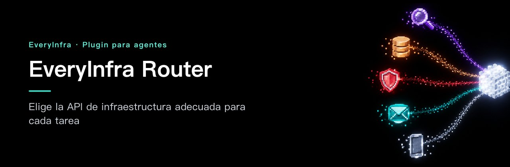

# EveryInfra Router — Elige la API de infraestructura adecuada para cada tarea

<!-- rq223-banner -->
<p align="center"></p>

<p align="center">
  <picture>
    <source media="(prefers-color-scheme: dark)" srcset="assets/hero-dark.svg">
    <source media="(prefers-color-scheme: light)" srcset="assets/hero-light.svg">
    
  </picture>
</p>

<p align="center">
  <a href="https://cursor.com/en/install-mcp?name=everyinfra&config=eyJ1cmwiOiJodHRwczovL2FwaS5ldmVyeWluZnJhLmNvbS9tY3AiLCJoZWFkZXJzIjp7IkF1dGhvcml6YXRpb24iOiJCZWFyZXIgPEFQSSBLZXk%2BIn19"></a>
  <a href="https://vscode.dev/redirect/mcp/install?name=everyinfra&config=%7B%22type%22%3A%22http%22%2C%22url%22%3A%22https%3A%2F%2Fapi.everyinfra.com%2Fmcp%22%2C%22headers%22%3A%7B%22Authorization%22%3A%22Bearer%20%3CAPI%20Key%3E%22%7D%7D"></a>
  <a href="https://github.com/everyinfra/everyinfra-agent-plugins/blob/main/i18n/README.es.md#claude-code"></a>
  <a href="https://github.com/everyinfra/everyinfra-agent-plugins/blob/main/i18n/README.es.md#codex"></a>
</p>

<p align="center">
  <a href="https://github.com/everyinfra/everyinfra-agent-plugins/stargazers"></a>
  &nbsp;<b>Dale una estrella al repo principal y recibe $1 de saldo.</b> <a href="https://everyinfra.com/es/docs?utm_source=github&utm_medium=readme&utm_campaign=everyinfra-router-plugin&utm_content=star_line#quickstart">Cómo reclamarlo →</a>
</p>

<p align="center"><a href="README.md">English</a> · <a href="README.zh-CN.md">简体中文</a> · <b>Español</b></p>

> [!TIP]
> **Este repositorio contiene una sola skill: EveryInfra Router.** El plugin completo de EveryInfra (10 skills, el servidor MCP remoto en `https://api.everyinfra.com/mcp` y la configuración para Claude Code, Codex, Cursor y VS Code) está en **[everyinfra/everyinfra-agent-plugins](https://github.com/everyinfra/everyinfra-agent-plugins)**. Los botones de arriba conectan el servidor MCP; la instalación del plugin en cada entorno está en el repo principal.

[Configuración](docs/setup.md) · [Flujo de trabajo](docs/workflow.md) · [Prompts](examples/prompts.md) · [Referencia de capacidades](docs/reference.md) · [Documentación de la API](https://api.everyinfra.com/docs) <sub>(en inglés)</sub>

> **Actualización (2026-10-09):** se retiraron las dos herramientas de limpieza de datos. Para limpiar, clasificar,
> extraer o resumir los datos que recopilas, usa la [API de IA](https://everyinfra.com/en/products/ai):
> `POST /api/v1/chat/completions`, compatible con OpenAI, también disponible como la herramienta MCP
> `everyinfra_chat`. Es gratuita para las cuentas que han recargado saldo, con límites por minuto que dependen
> del total recargado.

EveryInfra Router es una skill independiente para elegir la API de EveryInfra que corresponde. Relaciona el resultado que se pide con datos estructurados, búsqueda web, IA, CAPTCHA autorizados, correo, números de teléfono o proxies, y revisa el contrato MCP o REST aplicable antes de ejecutar nada.

Una petición como «recopila información pública y avisa a mi equipo» no es una sola operación: mezcla acceso a datos, investigación y un mensaje externo. El Router separa esas decisiones, elige el contrato de cada producto y señala dónde una llamada de pago o un envío necesitan aprobación.

## Qué puedes hacer

- Distinguir una petición de datos estructurados de una búsqueda en la web actual.
- Planificar un flujo con varios productos sin confundir el permiso para investigar con el permiso para enviar.
- Explicar qué parte de la petición está bloqueada por una capacidad, un alcance o una configuración que falta.

## Instalación

Es un paquete independiente con una sola skill y un flujo de trabajo **MCP y REST**; no es un servicio nuevo. Necesita un entorno de agente compatible y el acceso configurado que describe la [guía de configuración](docs/setup.md). Validar el paquete en local no demuestra que la API esté disponible.

Revisa el contenido del repositorio y luego instálalo en Codex. Estos comandos añaden un catálogo respaldado por GitHub, no un aval de ningún marketplace oficial:

```bash
codex plugin marketplace add everyinfra/everyinfra-router-plugin
codex plugin add everyinfra-router@everyinfra-router-plugin
```

Para una copia local, cambia la fuente del primer comando por `.`. La [guía de configuración](docs/setup.md) también cubre Claude Code y la conexión al servicio, que va aparte.

Con el acceso configurado, prueba:

> Necesito datos públicos sobre un conjunto de empresas. Decide si es una tarea de EveryData o de EverySearch e inspecciona las capacidades antes de proponer llamadas.

Este primer prompt solo inspecciona o prepara. Revisa cualquier operación de pago o efecto externo antes de seguir.

## Cómo funciona

1. Describe el resultado pedido, el destino y los efectos externos permitidos.
2. Asigna cada operación a un producto: EveryData para datos públicos estructurados, EverySearch para búsqueda web, EveryAI para procesar texto, EverySolve para desafíos autorizados, EveryMail para correo, EveryNumber para números y EveryProxy para tráfico.
3. Usa el descubrimiento MCP en vivo para los cuatro productos con MCP y el catálogo REST gratuito para los otros tres.
4. Presenta el plan de ejecución más pequeño, con los parámetros obligatorios y cada punto de aprobación por separado.
5. Ejecuta solo lo autorizado e informa por separado de resultados, cobros y acciones externas pendientes.

**Un buen resultado:** una decisión de enrutado con un producto por operación, el paso de descubrimiento, las entradas obligatorias, los efectos externos y cualquier requisito bloqueado. Un plan no demuestra que las operaciones posteriores hayan salido bien.

## Límites y seguridad

- Instalar el Router no instala las otras nueve skills ni configura sus servicios.
- Compartir una API key no significa que todos los productos estén habilitados.
- Que un producto aparezca en un catálogo no prueba que la cuenta pueda completar una operación de pago.

El paquete trae una sola skill: no concede permisos ni registra una segunda conexión MCP. No pongas credenciales en prompts, archivos del repositorio, capturas ni registros compartidos. Descubrir, ejecutar, cobrar y obtener un resultado externo final son estados distintos. Consulta la [política de seguridad](SECURITY.md).

## Preguntas frecuentes y validación

Las preguntas frecuentes, la comprobación sin conexión (`python3 scripts/validate.py`) y la guía para contribuir están en el [README en inglés](README.md#frequently-asked-questions).

Mantenido por [EveryInfra](https://everyinfra.com/es?utm_source=github&utm_medium=readme&utm_campaign=everyinfra-router-plugin&utm_content=footer). Licencia [Apache-2.0](LICENSE).
